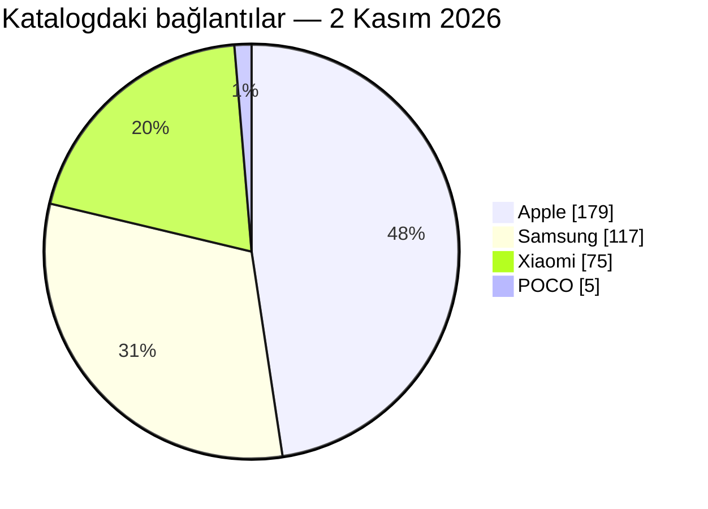

# 📱 Akıllı Telefon İndirim Takip Sistemi

[](https://github.com/Emir-Ars/Urun-indirim-takip/actions/workflows/ci.yml)


Trendyol ve Hepsiburada’daki akıllı telefonları keşfeden, fiyat ve stok
bilgilerini düzenli toplayıp PostgreSQL’de saklayan bir proje. Takip edilen
sayfalardan son toplanan teklifleri karşılaştırır ve fiyat geçmişi oluşturur.
Uzun vadeli hedef, bu geçmişten telefonun yakında indirime girme olasılığını
hesaplamaktır.

> ✅ Keşif, fiyat toplama, veritabanı, yerel API ve Streamlit ekranı tamamlandı
> ve gerçek verilerle doğrulandı. R2 + Platt modeli donduruldu; Cimri saklı
> testi çalıştırılıp doğrulandı. Kendi verimizde gölge mod planlandı: tahmin
> kaydı komutu kodlandı, resmi kayıt henüz başlamadı; ekranda tahmin yok.

## ✨ Özellikler

- 🔎 **Otomatik keşif:** model, kapasite ve renk seçeneklerinin bağlantılarını
  bulur; başka model, aksesuar ve kapsam dışı ürünleri kimlik kontrolünden geçirir.
  Haftalık keşif, yeterli kimlik kanıtı olan yeni sayfaları kataloğa kendiliğinden
  ekler; eksik veya çelişkili adaylar gerekçeyle dışarıda kalır.
- 🏷️ **Teklif seçimi:** ürün sayfasındaki uygun satıcı tekliflerini karşılaştırır;
  seçilen fiyatı, satıcıyı ve stok durumunu kaydeder.
- ⏰ **Düzenli toplama:** Windows Görev Zamanlayıcı ile günde iki fiyat turu ve
  haftalık keşif çalışır.
- 🗄️ **Kalıcı kayıt:** sonuçları tur ve sayfa düzeyinde saklar; tekrar kayıtları
  ve kapanmış sonuçların değiştirilmesini veritabanı kurallarıyla engeller.
- ⚖️ **Güvenli karşılaştırma:** cevap veren sayfa kümesi değişen turları fiyat
  düşüşü karşılaştırmasından ayırır. Okuma hatası stoksuzluk olarak kaydedilmez.
- 📅 **Bir defalık geçmiş aktarımı:** doğrulanmış Cimri geçmişini ayrı tabloda
  saklar; kendi gözlemlerimizle birleştirmez.
- 🌐 **Yerel API ve ekran:** kayıtlı teklifleri, iki ayrı fiyat geçmişini ve
  veri yeterliliği açıklanan istatistikleri salt okunur sunar; Streamlit ekranı
  telefon seçimi, teklif/istatistik kartları ve iki grafik gösterir. Doğrulanmış
  satıcı bağlantısını açar; sıfır fiyat farkını gri ve oksuz gösterir.

## 🔄 Çalışma akışı

```mermaid
flowchart LR
    A["Telefon hedefleri"] --> B["Keşif ve kimlik doğrulama"]
    B --> C["Doğrulanmış katalog"]
    C --> D["Fiyat ve stok toplama"]
    D --> E[("PostgreSQL fiyat geçmişi")]
    E --> F["Yerel salt okunur API"]
    F --> G["Yerel API istemcisi"]
    G --> H["Streamlit telefon ekranı"]
    classDef targets fill:#fff3bf,stroke:#b08900,color:#1b4332
    classDef processing fill:#d8f3dc,stroke:#2d6a4f,color:#1b4332
    classDef records fill:#dbeafe,stroke:#2563eb,color:#172554
    classDef preview fill:#f3e8ff,stroke:#9333ea,color:#581c87
    class A targets
    class B,D,F,G processing
    class C,E records
    class H preview
```



Telefonlar marka, model ve kapasite düzeyinde takip edilir. Keşif hangi
sayfaların izleneceğini belirler; toplama bu sayfaların fiyat, stoksuzluk veya
hata sonucunu kaydeder. Cimri geçmişi bu akışın gözlemleriyle birleştirilmez.

## 🛠️ Teknolojiler

| Teknoloji | Görevi |
|---|---|
| Python 3.13 | Keşif, fiyat toplama ve aktarım uygulaması |
| curl_cffi · BeautifulSoup4 | HTTP erişimi ve sayfa ayrıştırma |
| Pydantic | Veri şekilleri ve kimlik sözleşmelerinin doğrulanması |
| PostgreSQL 17 · Psycopg 3 | Kalıcı kayıt, SQL kuralları ve işlemler |
| FastAPI · Uvicorn · Psycopg Pool | Yerel, salt okunur API ve bağlantı havuzu |
| HTTPX | Yalnız yerel API'den veri alan doğrulayıcı istemci |
| Streamlit · Altair | Telefon ekranı, ayrı fiyat grafikleri ve yenileme |
| NumPy · scikit-learn · LightGBM | ML deneyleri (hazırlık sürüyor; ekranda tahmin yok) |
| Windows Görev Zamanlayıcı | Günlük toplama ve haftalık keşif |
| pytest · Black · Flake8 · GitHub Actions | Otomatik testler ve kod denetimleri |

## 🚀 Hızlı başlangıç

Windows ve PowerShell, proje klasöründe:

```powershell
python -m venv .venv
.venv\Scripts\python.exe -m pip install -e ".[dev,web,ml]"
.venv\Scripts\python.exe -m pytest -q
```

Veritabanı kurulumu, zamanlanmış görevler, keşif, fiyat turu, API ve ekranın
başlatılması [teknik rehberde](docs/teknik.md#komutlar) anlatılır.

## 📊 Güncel kapsam

2 Kasım 2026 itibarıyla (katalog; diğer sonuçlar kendi tarihini taşır):

| Alan | Durum |
|---|---|
| Fiyat kaynakları | Trendyol ve Hepsiburada |
| Keşif hedefleri | 25 (24 etkin): Apple 9, Samsung 8, Xiaomi 6, POCO 2 |
| Katalog | 60 ürün, 376 bağlantı (373 etkin); Hepsiburada 237, Trendyol 139 |
| Toplama düzeni | Her gün 10:00 ve 22:00; haftalık keşif Pazar 14:00 (otomatik güvenli kabul) |
| Cimri geçmişi | 4 Kasım salt okuma denetimi: 58 ürün, 22.595 tarihli kayıt (14 üründe 699 eksik fiyat), 9 Ekim 2025–2 Kasım 2026; ürünlerin kendi ilk–son kayıtları arasında kayıtsız gün yok. Galaxy S24 FE 128 GB 3 Kasım 2025'ten başlıyor; diğer 57 ürün 9 Ekim'den. Galaxy S25 512 GB ve Redmi Note 14 Pro 5G 256 GB eşleştirmesi yok; son alım 2 Kasım, düzenli alım yok. |
| Kendi toplama geçmişi | 4 Kasım 13:48 salt okuma denetimi: 28 Eylül 2026 15:39–4 Kasım 2026 10:34 (İstanbul); 73 tamamlanmış tur (71 zamanlanmış, 2 elle). 58 ürün bu tarih aralığında; Galaxy S24 FE 128 GB 19 Ekim'den başlıyor, Galaxy S25 512 GB son kontrolü 16 Ekim (etkin sayfası yok; son fiyat 13 Ekim). |
| Kendi geçmişimizdeki fiyat boşlukları | 4 Kasım denetimi; yalnız 3 Kasım sonuna kadar kapanmış günler: 2.199 ürün-günün 1.796'sında en az bir ham fiyat, 310'unda yalnız stoksuz sonuç, 16'sında fiyat yok ve hata var, 77'sinde hiç kontrol yok. ML için kullanılabilir 22:00 fiyatı 776 ürün-günde, günlük minimum 463 ürün-günde yok; bu iki sayı birbirine eklenmez ve ham fiyat yokluğuyla aynı ölçü değildir. |
| Otomatik testler | 2374 test, 0 atlanan; Black ve Flake8 temiz (4 Kasım) |
| ML etiket denetimi | Son alımı içeren 2 Kasım görüntüsüyle (son kapanmış gün 1 Kasım) doğrulandı: kendi serimizde 0 kullanılabilir / 1.323 belirsiz (30 gün geçmişi dolan 27 Ekim–1 Kasım başlangıçlarının gelecek penceresi henüz kapanmadı); Cimri'de 19.561 kullanılabilir (2.086 olumlu, 17.475 olumsuz) / 2.231 belirsiz. Sıkı çapraz kontrolde 24.616 pencere kaydı eşleşti. |
| ML girdi denetimi | Aynı görüntüyle 2 Kasım'da doğrulandı: kendi serimizde 1.323, Cimri'de 21.792 girdi satırı; toplam 23.115 başlangıç 4.2 ile birebir eşleşti, eksik/fazla/tekrarlı başlangıç ve tanınmayan model ailesi yok. |
| ML bölme denetimi | Aynı görüntüyle 2 Kasım'da doğrulandı: eğitim 13.647, doğrulama 2.531, saklı test 2.632 kayıt (3 Eylül–25 Ekim 2026); purge 751 kayıt. Dört kat Nisan–Temmuz 2026; bütün eğitim/kalibrasyon/doğrulama dilimleri iki sınıflı. Bu bölme adımında test sınıf dağılımı veya puanı açılmadı; sonraki son test aşağıda. |
| ML ilk gerçek deney | 3 Kasım: aynı 2 Kasım kanıtlarıyla Nisan–Temmuz 2026 dört kat, 5.267 doğrulama satırı / 524 olumlu (%9,95); çıkış 0, süre 44,33 sn. Dosya/üyelik denetimi ve kayıtlı tahminlerden yedi modelin kat/birleşik puanları doğrulandı. Saklı test ve kendi serimiz puanlanmadı. |
| ML deney puanları | 3 Kasım birleşik doğrulama: R2 + Platt AP 0,2679 / Brier 0,0835 / log loss 0,3151; LightGBM + Platt AP 0,2770 / Brier 0,0822 / log loss 0,2931. LightGBM + Platt'ın R0'a göre Brier skill değeri 0,0834. |
| ML seçim önerisi | 3 Kasım: karşılanmadı (`not_met`). LightGBM + Platt − R2 + Platt AP farkı +0,0091; %95 tarih bloklu aralık [−0,0483; +0,1025], alt sınır >0 değil. Dört hazır kat, Brier ve log loss koşulları sağlandı; üç karşılaştırmada da 2.000/2.000 geçerli bootstrap tekrarı. Deney komutu modeli dondurmaz; sonraki [ön kayıtta](docs/teknik.md#4-kasım-2026-dondurma-ön-kaydı) R2 + Platt donduruldu. |
| ML ürün değerlendirme desteği | 3 Kasım: en az 5 olumlu pencere kümesi şartını 58 üründen 2'si sağlıyor; LightGBM + Platt makro AP 0,7579 yalnız bu ürünlerin ortalaması. POCO 4 kümeyle yetersiz; birleşik 103 olumlu pencere kümesi bağımsız gerçek düşüş sayısı değildir. Ürün bazındaki sonuçlar bütün kataloğa genellenemez. |
| ML saklı test kapsamı | 4 Kasım: ön kayıtlı R2 + Platt ile tek açılış, 3 Eylül–25 Ekim 2026 başlangıçları; 2.632 satır / 349 olumlu (%13,26), 56 ürün. Çıkış 0, süre 25,76 sn; model değişmedi, kendi serimiz puanlanmadı. |
| ML saklı test puanları | 4 Kasım: R0 AP 0,1326 / Brier 0,1160 / log loss 0,3961; R2 + Platt AP 0,3931 / Brier 0,1046 / log loss 0,3560 / R0'a göre Brier skill 0,0977. Dosya/üyelik denetimi ve kayıtlı tahminlerden bağımsız puan hesabı doğrulandı. |
| ML saklı test okuması | 4 Kasım: model − R0 AP farkı +0,2605; %95 tarih bloklu aralık [+0,2377; +0,3093], 14 günlük bloklar, 2.000/2.000 geçerli tekrar. Brier skill ve AP alt sınırı pozitif; önceden belirlenen okuma koşulları karşılandı (`met`), model seçimi değişmedi. |
| ML saklı test desteği | 4 Kasım: 61 olumlu pencere kümesi; bağımsız gerçek düşüş sayısı değildir. En az 5 küme eşiğine ulaşan ürün 0/56; ürün makro puanları hesaplanmadı. POCO 2 kümeyle yetersiz; Apple, Samsung ve Xiaomi marka kırılımları destekli. Kalibrasyon ve kapsam sınırları [sonuç değerlendirmesinde](docs/teknik.md#4-kasım-2026-saklı-test-sonucu). |
| Gölge mod ilk deneme kaydı | 4 Kasım, 12:57 UTC görüntüsü (son kapanmış gün 3 Kasım), kullanıcı terminalinde çıkış 0: 27 Ekim–3 Kasım kendi başlangıçları için 398 kayıt, 389 olasılık (9 satır 30 günden kısa geçmişli), 368 gösterilebilir. Deneme klasörüdür, resmi kayıt değildir. Parmak izleri, girdiler (`features` çıktısıyla 398/398 aynı) ve olasılıklar (`model.json` katsayılarından, pickle açılmadan; en çok 1×10⁻¹⁶ fark) bağımsız doğrulandı. Etiketler okunmadı. |
| Gölge mod olasılık dağılımı | 4 Kasım deneme kaydı, yalnız bilgi: R2 + Platt ortalaması 0,168, medyan 0,158, en çok 0,404; eğitim olumlu oranı (R0) 0,102. 389 olasılığın 118'i ≥ 0,20, 12'si ≥ 0,30. Ortalamanın R0'ın üstünde olması [planda ölçülen girdi kaymasıyla](proje_plani.md#gölge-mod-kalan-sıra-6-4-kasım-planı) aynı yöndedir; nedenleri bu kayıttan ayrıştırılamaz ve kendi verimizde doğruluk veya kalibrasyon göstermez. |

Katalogdaki **376 bağlantının markalara göre dağılımı** (üç pasif bağlantı dahil):



Katalog pazaryerlerinin tamamını kapsamaz; Hepsiburada araması kısmi
taranabiliyor. Kaynak ve işletim sınırları
[teknik rehberde](docs/teknik.md#bilinen-sınırlar) açıklanır. Otomatik testler
canlı ağa çıkmaz; veritabanı testleri yalnız test veritabanını kullanır.

## 🗺️ Yol haritası

| Aşama | Durum |
|---|---|
| Fiyat okuma, keşif, katalog, veritabanı ve zamanlanmış toplama | ✅ Tamamlandı |
| FastAPI ve Streamlit ile verileri sunma ve görüntüleme | ✅ Tamamlandı |
| ML öncesi bakım ve otomatik güvenli keşif kabulü | ✅ Tamamlandı |
| Proje yapısının sadeleştirilmesi | ✅ Tamamlandı (26 Ekim) |
| Sürekli çalışma ortamı | 🔄 Dizüstü sürekli açık kararı uygulandı; işletim doğrulaması sürüyor ([plan](proje_plani.md)) |
| ML ile indirim olasılığı tahmini | 🔄 R2 + Platt donduruldu, Cimri saklı testi çalıştırılıp doğrulandı; ön kayıt ve sonuç belgeleri gönderildi, CI doğrulandı. Kendi verimizde gölge mod planı onaylandı, tahmin kaydı komutu kodlandı (günlük görev ve resmi kayıt sırada); ekranda tahmin gösterim kapısından sonra ([plan](proje_plani.md#gölge-mod-kalan-sıra-6-4-kasım-planı)) |

## 📚 Belgeler

- [Proje planı](proje_plani.md): kararlar, aşama durumu, açık kararlar ve sıradaki iş.
- [Teknik rehber](docs/teknik.md): kurulum, komutlar, veri kuralları ve bilinen sınırlar.
- [Geliştirme geçmişi](docs/gecmis.md): her adımın tarihi, commit'i ve CI sonucu.
- [Arşiv](docs/arsiv/): 20 Ekim 2026'ya kadarki ayrıntılı plan ve rehber.
