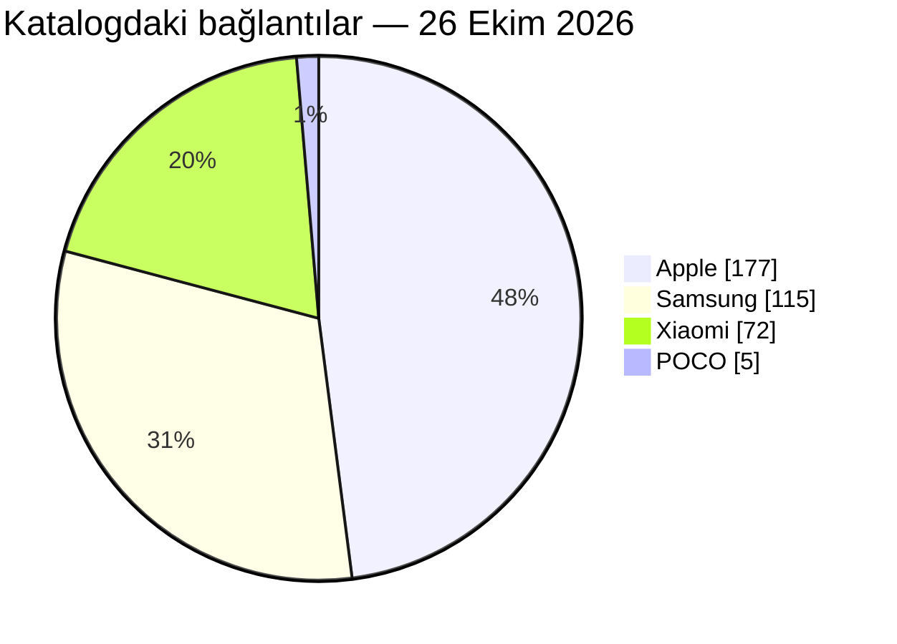

# 📱 Akıllı Telefon İndirim Takip Sistemi

[](https://github.com/Emir-Ars/Urun-indirim-takip/actions/workflows/ci.yml)


Trendyol ve Hepsiburada’daki akıllı telefonları keşfeden, fiyat ve stok
bilgilerini düzenli toplayıp PostgreSQL’de saklayan bir proje. Takip edilen
sayfalardan son toplanan teklifleri karşılaştırır ve fiyat geçmişi oluşturur.
Uzun vadeli hedef, bu geçmişten telefonun yakında indirime girme olasılığını
hesaplamaktır.

> ✅ Keşif, fiyat toplama, veritabanı, yerel API ve Streamlit ekranı tamamlandı
> ve gerçek verilerle doğrulandı. Tahmin modeli henüz yok.

## ✨ Özellikler

- 🔎 **Otomatik keşif:** model, kapasite ve renk seçeneklerinin bağlantılarını
  bulur; başka model, aksesuar ve kapsam dışı ürünleri kimlik kontrolünden geçirir.
  Haftalık keşif, yeterli kimlik kanıtı olan yeni sayfaları kataloğa kendiliğinden
  ekler; eksik veya çelişkili adaylar gerekçeyle dışarıda kalır.
- 🏷️ **Teklif seçimi:** ürün sayfasındaki uygun satıcı tekliflerini karşılaştırır;
  seçilen fiyatı, satıcıyı ve stok durumunu kaydeder.
- ⏰ **Düzenli toplama:** Windows Görev Zamanlayıcı ile günde iki fiyat turu ve
  haftalık keşif çalışır.
- 🗄️ **Kalıcı kayıt:** sonuçları tur ve sayfa düzeyinde saklar; tekrar kayıtları
  ve kapanmış sonuçların değiştirilmesini veritabanı kurallarıyla engeller.
- ⚖️ **Güvenli karşılaştırma:** cevap veren sayfa kümesi değişen turları fiyat
  düşüşü karşılaştırmasından ayırır. Okuma hatası stoksuzluk olarak kaydedilmez.
- 📅 **Bir defalık geçmiş aktarımı:** doğrulanmış Cimri geçmişini ayrı tabloda
  saklar; kendi gözlemlerimizle birleştirmez.
- 🌐 **Yerel API ve ekran:** kayıtlı teklifleri, iki ayrı fiyat geçmişini ve
  veri yeterliliği açıklanan istatistikleri salt okunur sunar; Streamlit ekranı
  telefon seçimi, teklif/istatistik kartları ve iki grafik gösterir. Doğrulanmış
  satıcı bağlantısını açar; sıfır fiyat farkını gri ve oksuz gösterir.

## 🔄 Çalışma akışı

```mermaid
flowchart LR
    A["Telefon hedefleri"] --> B["Keşif ve kimlik doğrulama"]
    B --> C["Doğrulanmış katalog"]
    C --> D["Fiyat ve stok toplama"]
    D --> E[("PostgreSQL fiyat geçmişi")]
    E --> F["Yerel salt okunur API"]
    F --> G["Yerel API istemcisi"]
    G --> H["Streamlit telefon ekranı"]
    classDef targets fill:#fff3bf,stroke:#b08900,color:#1b4332
    classDef processing fill:#d8f3dc,stroke:#2d6a4f,color:#1b4332
    classDef records fill:#dbeafe,stroke:#2563eb,color:#172554
    classDef preview fill:#f3e8ff,stroke:#9333ea,color:#581c87
    class A targets
    class B,D,F,G processing
    class C,E records
    class H preview
```



Telefonlar marka, model ve kapasite düzeyinde takip edilir. Keşif hangi
sayfaların izleneceğini belirler; toplama bu sayfaların fiyat, stoksuzluk veya
hata sonucunu kaydeder. Cimri geçmişi bu akışın gözlemleriyle birleştirilmez.

## 🛠️ Teknolojiler

| Teknoloji | Görevi |
|---|---|
| Python 3.13 | Keşif, fiyat toplama ve aktarım uygulaması |
| curl_cffi · BeautifulSoup4 | HTTP erişimi ve sayfa ayrıştırma |
| Pydantic | Veri şekilleri ve kimlik sözleşmelerinin doğrulanması |
| PostgreSQL 17 · Psycopg 3 | Kalıcı kayıt, SQL kuralları ve işlemler |
| FastAPI · Uvicorn · Psycopg Pool | Yerel, salt okunur API ve bağlantı havuzu |
| HTTPX | Yalnız yerel API'den veri alan doğrulayıcı istemci |
| Streamlit · Altair | Telefon ekranı, ayrı fiyat grafikleri ve yenileme |
| Windows Görev Zamanlayıcı | Günlük toplama ve haftalık keşif |
| pytest · Black · Flake8 · GitHub Actions | Otomatik testler ve kod denetimleri |

## 🚀 Hızlı başlangıç

Windows ve PowerShell, proje klasöründe:

```powershell
python -m venv .venv
.venv\Scripts\python.exe -m pip install -e ".[dev,web]"
.venv\Scripts\python.exe -m pytest -q
```

Veritabanı kurulumu, zamanlanmış görevler, keşif, fiyat turu, API ve ekranın
başlatılması [teknik rehberde](docs/teknik.md#komutlar) anlatılır.

## 📊 Güncel kapsam

26 Ekim 2026 itibarıyla (katalog; test sonucu kendi tarihini taşır):

| Alan | Durum |
|---|---|
| Fiyat kaynakları | Trendyol ve Hepsiburada |
| Keşif hedefleri | 25 (24 etkin): Apple 9, Samsung 8, Xiaomi 6, POCO 2 |
| Katalog | 60 ürün, 369 bağlantı (366 etkin); Hepsiburada 234, Trendyol 135 |
| Toplama düzeni | Her gün 10:00 ve 22:00; haftalık keşif Pazar 14:00 (otomatik güvenli kabul) |
| Cimri geçmişi | 57 ürün, 20.805 tarihli kayıt (553 eksik fiyat); iki ürün eşleştirilemedi |
| Otomatik testler | 1975 test, 0 atlanan; Black ve Flake8 temiz (26 Ekim) |

Katalogdaki **369 bağlantının markalara göre dağılımı** (üç pasif bağlantı dahil):



Katalog pazaryerlerinin tamamını kapsamaz; Hepsiburada araması kısmi
taranabiliyor. Kaynak ve işletim sınırları
[teknik rehberde](docs/teknik.md#bilinen-sınırlar) açıklanır. Otomatik testler
canlı ağa çıkmaz; veritabanı testleri yalnız test veritabanını kullanır.

## 🗺️ Yol haritası

| Aşama | Durum |
|---|---|
| Fiyat okuma, keşif, katalog, veritabanı ve zamanlanmış toplama | ✅ Tamamlandı |
| FastAPI ve Streamlit ile verileri sunma ve görüntüleme | ✅ Tamamlandı |
| ML öncesi bakım ve otomatik güvenli keşif kabulü | ✅ Tamamlandı |
| Proje yapısının sadeleştirilmesi | ✅ Tamamlandı (26 Ekim) |
| Sürekli çalışma ortamı | 🔄 Dizüstü sürekli açık kararı uygulandı; işletim doğrulaması sürüyor ([plan](proje_plani.md)) |
| ML ile indirim olasılığı tahmini | 🔜 Sürekli işletim ve yeterli veri sonrasında |

## 📚 Belgeler

- [Proje planı](proje_plani.md): kararlar, aşama durumu, açık kararlar ve sıradaki iş.
- [Teknik rehber](docs/teknik.md): kurulum, komutlar, veri kuralları ve bilinen sınırlar.
- [Geliştirme geçmişi](docs/gecmis.md): her adımın tarihi, commit'i ve CI sonucu.
- [Arşiv](docs/arsiv/): 20 Ekim 2026'ya kadarki ayrıntılı plan ve rehber.
