# 📱 Akıllı Telefon İndirim Takip Sistemi

[](https://github.com/Emir-Ars/Urun-indirim-takip/actions/workflows/ci.yml)


Trendyol ve Hepsiburada’daki akıllı telefonları keşfeder, fiyat ve stok
sonuçlarını PostgreSQL’de saklar ve yerel ekranda karşılaştırır. Canlı
Windows sistemi toplama ve gölge tahmini sürdürür. Docker kopyası
hazırlanmış veriyi tarayıcıdan sunar.

Gerçek indirim olasılığı gösterimi kapalıdır. Gösterim kararı
[5 Ocak 2027 kesin değerlendirmesine](proje_plani.md#65-kontrol-planı)
bağlıdır.

## ✨ Özellikler

- **Keşif ve katalog.** Telefonlar marka, model ve kapasite düzeyinde
  izlenir. Haftalık keşif, yeterli kimlik kanıtı olan sayfaları
  kataloğa ekler. Eksik veya çelişkili adaylar gerekçeleriyle raporlanır.
- **Fiyat ve stok.** Uygun satıcı teklifleri arasından seçilen fiyat,
  satıcı ve stok durumu tur ve sayfa bazında kaydedilir. Fiyat düşüşü
  yalnız cevap veren sayfa kümeleri eşleştiğinde karşılaştırılır.
- **Yerel API ve ekran.** Salt okunur API güncel teklifleri,
  istatistikleri ve iki ayrı geçmişi sunar. Streamlit ekranı telefon
  seçimi, satıcı bağlantısı, tahmin kartı ve iki grafik gösterir.
  Bir defalık Cimri geçmişi projenin kendi ölçümlerinden ayrı tutulur.
- **Gölge tahmin.** Dondurulan R2 + Platt modeli, her uygun başlangıç
  için sonraki 7 günde en az %5 fiyat düşüşü olasılığını bir kez kaydeder.
  Sonraki görüntüyle gerçekleşen fiyatlar ve gösterim koşulları ölçülür.
  [Güvenilirlik grafiği](docs/teknik.md#güvenilirlik-grafiği-python--m-appml-reliability-chart)
  rapor kovalarını SVG'ye çevirir (`python -m app.ml reliability-chart`).
- **Docker teslimi.** Ayrı PostgreSQL, FastAPI ve Streamlit kopyası
  hazırlanmış paketle açılır. Yeni paket yüklenebilir ve önceki
  pakete dönülebilir.

## 🔄 Çalışma akışı

```mermaid
flowchart LR
    A["Telefon hedefleri"] --> B["Keşif ve kimlik doğrulama"]
    B --> C["Doğrulanmış katalog"]
    C --> D["Fiyat ve stok toplama"]
    D --> E[("PostgreSQL fiyat geçmişi")]
    E --> F["Yerel salt okunur API"]
    F --> G["Yerel API istemcisi"]
    G --> H["Streamlit telefon ekranı"]
    E --> I["Salt okunur veri görüntüsü"]
    I --> J["Dondurulan modelle gölge tahmin"]
    J --> K["Değişmez tahmin kayıtları"]
    I --> L["Kayıtlı tahminleri değerlendirme"]
    K --> L
    K -->|Onaylı güncel kayıt| F
    L --> M["Kapı ve sağlık raporu"]
    E --> N["Export: veri, model ve kayıt paketi"]
    K --> N
    N --> O["Prepare: Docker DB, API ve Streamlit"]
    classDef targets fill:#fff3bf,stroke:#b08900,color:#1b4332
    classDef processing fill:#d8f3dc,stroke:#2d6a4f,color:#1b4332
    classDef records fill:#dbeafe,stroke:#2563eb,color:#172554
    classDef preview fill:#f3e8ff,stroke:#9333ea,color:#581c87
    class A targets
    class B,D,F,G,J,L processing
    class C,E,I,K records
    class H,M,O preview
    class N records
```



Katalog hangi sayfaların izleneceğini belirler. Kapanmış sonuçlar ve
kayıtlı tahminler korunur. Tahmin kartı ayrı API ucundan okur ve tahmin
hatası fiyat ekranını durdurmaz.
[Kurallar ve hata kodları](docs/teknik.md)

## 🛠️ Teknolojiler

| Alan | Araçlar |
|---|---|
| Keşif ve fiyat okuma | Python 3.13, curl_cffi, BeautifulSoup4, Pydantic |
| Veritabanı ve API | PostgreSQL 17, Psycopg 3, FastAPI, Uvicorn |
| Yerel ekran | HTTPX, Streamlit, Altair |
| Model ve ölçüm | NumPy, scikit-learn, LightGBM |
| İşletim ve teslim | Windows Görev Zamanlayıcı, Docker Desktop, Compose |
| Doğrulama | pytest, Black, Flake8, GitHub Actions |

## 🚀 Hızlı başlangıç

### Teslim kopyasını kullanma

Windows 11 x64, Docker Desktop/WSL2, uygun proje sürümü ve ayrı veri
paketi gerekir. [Teslim rehberindeki](docs/teslim.md) Prepare işlemi
bittikten sonra proje klasöründe çalıştır.

```powershell
powershell.exe -NoProfile -ExecutionPolicy Bypass -File .\scripts\teslim.ps1 -Action Start
```

Hazır mesajından sonra ekran **http://127.0.0.1:8503** adresindedir.
Teslim kopyasına yeni veri, kaynak bilgisayardan alınan paketle aktarılır.

### Kaynak sistemi geliştirme ve veri toplama

Canlı Windows sistemi için proje klasöründe geliştirici ortamını kur.

```powershell
python -m venv .venv
.venv\Scripts\python.exe -m pip install -e ".[dev,web,ml]"
.venv\Scripts\python.exe -m pytest -q
```

[Kurulum ve çalıştırma komutları](docs/teknik.md#komutlar), veritabanı,
zamanlanmış görev, API ve ekran adımlarını içerir. İki test bağlantısı
aynı `_test` veritabanını kullanır. Ayar eksikse ilgili yerel testler
atlanır. [Test ortamı](docs/teknik.md#test-ortamı-ve-sınırı)

Model ve kanıt dosyaları Git dışındadır. Gerekli yollar
[gölge tahmin rehberindedir](docs/teknik.md#gölge-mod-tahmin-kaydı-python--m-appml-shadow-predict).

## 📊 Güncel kapsam

Katalog 23 Kasım 2026'da doğrulandı. Ölçüm tarihleri ilgili satırlardadır.

| Alan | Durum |
|---|---|
| Kaynaklar ve keşif hedefleri | Trendyol ve Hepsiburada. 25 hedefin 24'ü etkin. Apple 9, Samsung 8, Xiaomi 6, POCO 2. |
| Katalog | 61 ürünün 60'ı ve 396 bağlantının 391'i etkin. Toplam 246 Hepsiburada, 150 Trendyol bağlantısı var. Sayfası olmayan Galaxy S25 512 GB, 20 Kasım'da pasife alındı. |
| Bağlantıların markalara dağılımı | Apple 183, Samsung 129, Xiaomi 79, POCO 5. Pasif bağlantılar dahil. |
| Görev saatleri (İstanbul) | Fiyat turu her gün 10:00 ve 22:00. Gölge tahmin 11:00. Otomatik kabul yapan haftalık keşif Pazar 14:00. |
| Cimri geçmişi | 4 Kasım denetimi. 58 ürün, 22.595 kayıt, 14 üründe 699 eksik fiyat. 9 Ekim 2025–2 Kasım 2026. S24 FE 128 GB 3 Kasım 2025'te, diğer 57 ürün 9 Ekim'de başlar. Ürünlerin kendi ilk ve son kayıtları arasında kayıtsız gün yok. Galaxy S25 512 GB ile Redmi Note 14 Pro 5G 256 GB eşleştirmesi bulunamadı. Son alım 2 Kasım. |
| Kendi toplama geçmişi | 23 Kasım 11:00 görüntüsü, 28 Eylül 15:39–23 Kasım 10:36. 111 turun 110'u tamamlandı (108 zamanlanmış, 2 elle), biri yarıda kaldı. 39.459 planlı sayfa kontrolünde 39.332 sonuç var. Geçmişte kaldırılan bağlantı dahil 397 sayfa, katalogla eşleşen 391 etkin sayfa. |
| Fiyat boşlukları | 4 Kasım denetiminde, 3 Kasım'a kadar kapanmış 2.199 ürün-günün 1.796'sında fiyat, 310'unda yalnız stoksuz sonuç, 16'sında fiyat yerine hata, 77'sinde kontrol yok. ML için 22:00 başlangıç fiyatı 776, günlük minimum 463 ürün-günde bulunamadı. Son iki sayı farklı ölçümlerdir. |
| Haftalık işletim ve yedek | 16–22 Kasım'da 14 turun 13'ü zamanında başlayıp tamamlandı. 20 Kasım akşam turu güç kaybıyla yarıda kaldı ve ertesi sabah `interrupted` kapatıldı. Yedi gölge görevi çıkış 0 verdi. 22 Kasım keşfi 48 hedef-kaynak çiftinin 19'unu tam taradı ve fiyatı sonraki turda doğrulanan beş Hepsiburada sayfası ekledi. 23 Kasım yedeğinin E: ve OneDrive kopyaları doğrulandı. |
| Otomatik testler | 23 Kasım'da iki test rolüyle 2.677 test geçti, 0 test atlandı, 56 uyarı bildirildi. Black ve Flake8 geçti. |
| Docker gerçek paket kabulü | 10 Kasım 11:14 paketi. 57 dosya, 60 ürün, 85 tur, 29.447 sayfa sonucu, 22.595 Cimri satırı. Veri, şema ve dosya parmak izleri eşleşti. Salt okunur API rolü, grafikler, aktarım bildirimi ve kapalı tahmin doğrulandı. |

Hepsiburada araması kısmi kalabilir. Katalog takip için doğrulanmış
sayfaları içerir. Otomatik testler, test verisi ve kontrollü yanıtlarla
çalışır. [Kaynak ve işletim sınırları](docs/teknik.md#bilinen-sınırlar)

### Model ölçümleri

| Ölçüm | Sonuç |
|---|---|
| Cimri doğrulaması | 3 Kasım deneyinde 5.267 satır, 524 olumlu. AP farkı güven aralığının alt sınırı pozitif çıkmayınca LightGBM seçim koşulu karşılanmadı. [Dondurma ön kaydı](docs/teknik.md#4-kasım-2026-dondurma-ön-kaydı) |
| Cimri saklı testi | 4 Kasım'da R2 + Platt ile tek açılış. 3 Eylül–25 Ekim başlangıçlarından 2.632 satır (56 ürün, 349 olumlu). R0 AP 0,1326 ve Brier 0,1160. R2 + Platt AP 0,3931, Brier 0,1046, log loss 0,3560 ve Brier skill 0,0977. AP farkı +0,2605 ve %95 aralık +0,2377…+0,3093. Okuma koşulu `met`. Ürün bazında destek yetersizdi. [Saklı testin kapsamı ve sınırları](docs/teknik.md#4-kasım-2026-saklı-test-sonucu) |
| Gölge kayıtları | 23 Kasım'da 17 klasörde 1.240 tekil kayıt ve 1.212 olasılık. Beklenen kayıtlar tam, yarım klasör yok. 18 Kasım'daki 1.039 kayıt korundu. Asıl sonuca 876 kayıt girdi, 121'i olumlu. 343 `y_sabit` etiketi belirsiz. Son 14 gündeki fiyat boşlukları nedeniyle 21 etiketli kayıt asıl sonucun dışında kaldı. |
| Gölge ara raporu | 23 Kasım asıl sonucu. R0 AP 0,1381 ve Brier 0,1204. R2 + Platt AP 0,3069, Brier 0,1112, log loss 0,3723 ve Brier skill 0,0759. Üç performans koşulu sağlandı. Veri desteği 20 takvim günü, Kasım dışında 5 etiketli gün ve 28 olumlu pencere kümesiyle yetersiz kaldı. Kapı **Değerlendirilemedi**. [Gölge değerlendirme kuralları](docs/teknik.md#gölge-değerlendirmesi-python--m-appml-shadow-evaluate) |

AP, modelin olumlu örnekleri sıralamasını ölçer. Cimri saklı testi ve
kendi verimizdeki gölge değerlendirme farklı dönem ve kaynaklara aittir.
[Sadeleştirme öncesi ayrıntılı tablo](docs/arsiv/README_2026-11-23.md#-güncel-kapsam)
· [Geliştirme ve doğrulama geçmişi](docs/gecmis.md)

## 🗺️ Yol haritası

Keşif, fiyat toplama, PostgreSQL kayıtları, API/ekran, gölge kayıt ve
Docker teslim yazılımı yerel kabul ve CI'dan geçti. İkinci fiziksel
bilgisayarda kurulum ve ağsız kullanım teslim sınırıdır.
[Teslim kabulünün kapsamı](docs/teslim.md#kabulün-kapsamı)

### Düzenli takip ve bekleyen işler

Haftalık sistem/model kontrolü ve yedek sürer. Sunum, final teslim ve
5 Ocak kesin değerlendirmesi [güncel takip tablosundadır](proje_plani.md#güncel-takip-tablosu).
Güvenilirlik grafiği teslim kapsamındadır. Ablasyon ve TL kaybı raporu
için kapsam kararı [plandadır](proje_plani.md#ml-ikincil-hedeflerinin-kapsamı).

## 📚 Belgeler

| Belge | İçerik |
|---|---|
| [Proje planı](proje_plani.md) | Kararlar, ilerleme ve sıradaki iş |
| [Teslim rehberi](docs/teslim.md) | İlk hazırlık, açılış, veri yenileme ve geri dönüş |
| [Teknik rehber](docs/teknik.md) | Kurulum, komutlar, kurallar ve sınırlar |
| [Geliştirme geçmişi](docs/gecmis.md) | Adımlar, commit ve CI sonuçları |
| [Çalışma kuralları](AGENTS.md) | Projede uygulanan ortak kurallar |
| [Arşiv](docs/arsiv/) | Önceki belge sürümleri ve tarihli incelemeler |
