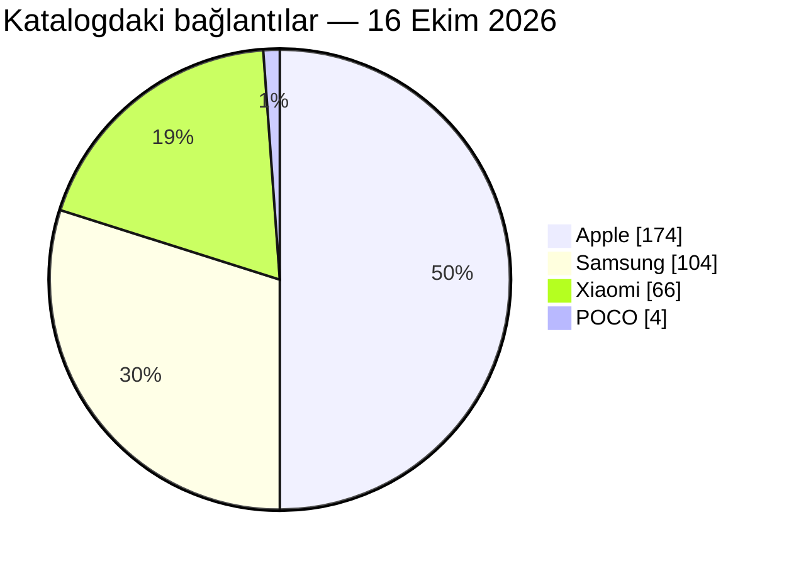

# 📱 Akıllı Telefon İndirim Takip Sistemi

Trendyol ve Hepsiburada’daki akıllı telefonları keşfeden, fiyat ve stok
bilgilerini düzenli toplayıp PostgreSQL’de saklayan bir proje. Takip edilen
sayfalardan son toplanan teklifleri karşılaştırır ve fiyat geçmişi oluşturur.
Uzun vadeli hedef, bu geçmişten telefonun yakında indirime girme olasılığını
hesaplamaktır.

> ✅ **Keşif, fiyat toplama ve veritabanı aşamaları tamamlandı.**
> Salt okunur yerel API, veriyi doğrulayan istemci ve fiyat istatistikleri hazır.
> Streamlit ekranı gerçek verilerle SQL–API karşılaştırmasından ve tarayıcı
> kontrolünden geçti. Aşama 7 tamamlandı ve gönderildi; aynı commit'in CI'ı başarılı.
> Tahmin modeli henüz yok.

## ✨ Tamamlanan özellikler

- 🔎 **Otomatik keşif:** model, kapasite ve renk seçeneklerinin bağlantılarını
  bulur; başka model, aksesuar ve kapsam dışı ürünleri kimlik kontrolünden geçirir.
- 🏷️ **Teklif seçimi:** ürün sayfasındaki uygun satıcı tekliflerini karşılaştırır;
  seçilen fiyatı, satıcıyı ve stok durumunu kaydeder.
- ⏰ **Düzenli toplama:** Windows Görev Zamanlayıcı ile günde iki fiyat turu ve
  haftalık keşif raporu üretir. Yeni bağlantılar incelenen rapordan kataloğa alınır.
- 🗄️ **Kalıcı kayıt:** sonuçları tur ve sayfa düzeyinde saklar; tekrar kayıtları
  ve kapanmış sonuçların değiştirilmesini veritabanı kurallarıyla engeller.
- ⚖️ **Güvenli karşılaştırma:** cevap veren sayfa kümesi değişen turları fiyat
  düşüşü karşılaştırmasından ayırır. Okuma hatası stoksuzluk olarak kaydedilmez.
- 📅 **Bir defalık geçmiş aktarımı:** doğrulanmış Cimri geçmişini ayrı tabloda
  saklar; tekrar aktarımda kayıt çoğaltmadan ilk kaynak bilgilerini korur.
- 🌐 **Yerel API:** kayıtlı teklifleri, iki ayrı fiyat geçmişini ve veri
  yeterliliği açıklanan istatistikleri salt okunur sunar.
- 🔗 **Yerel istemci:** API cevaplarını ortak sözleşmeyle doğrular;
  eksik veri ve bağlantı hatalarını anlaşılır mesajlarla bildirir.

🖥️ **Telefon ekranı:** Telefon seçimi, teklif/istatistik kartları ve ayrı
kendi/Cimri grafikleri hazır. Gerçek verilerle seçimler, hata sonrası
toparlanma, dar ekran ve 30 saniyelik yenileme doğrulandı.

## 🔄 Çalışma akışı

```mermaid
flowchart LR
    A["Telefon hedefleri"] --> B["Keşif ve kimlik doğrulama"]
    B --> C["Doğrulanmış katalog"]
    C --> D["Fiyat ve stok toplama"]
    D --> E[("PostgreSQL fiyat geçmişi")]
    E --> F["Yerel salt okunur API"]
    F --> G["Yerel API istemcisi"]
    G --> H["Streamlit telefon ekranı"]
    classDef targets fill:#fff3bf,stroke:#b08900,color:#1b4332
    classDef processing fill:#d8f3dc,stroke:#2d6a4f,color:#1b4332
    classDef records fill:#dbeafe,stroke:#2563eb,color:#172554
    classDef preview fill:#f3e8ff,stroke:#9333ea,color:#581c87
    class A targets
    class B,D,F,G processing
    class C,E records
    class H preview
```

Telefonlar marka, model ve kapasite düzeyinde takip edilir. Keşif hangi
sayfaların izleneceğini belirler; toplama bu sayfaların fiyat, stoksuzluk veya
hata sonucunu kaydeder. Cimri geçmişi bu akışın gözlemleriyle birleştirilmez.

## 🛠️ Teknolojiler

| Teknoloji | Görevi |
|---|---|
| Python 3.13 | Keşif, fiyat toplama ve aktarım uygulaması |
| curl_cffi · BeautifulSoup4 | HTTP erişimi ve sayfa ayrıştırma |
| Pydantic | Veri şekilleri ve kimlik sözleşmelerinin doğrulanması |
| PostgreSQL 17 · Psycopg 3 | Kalıcı kayıt, SQL kuralları ve işlemler |
| FastAPI · Uvicorn · Psycopg Pool | Yerel, salt okunur API ve bağlantı havuzu |
| HTTPX | Yalnız yerel API'den veri alan doğrulayıcı istemci |
| Streamlit · Altair | Telefon ekranı, ayrı fiyat grafikleri ve yenileme |
| Windows Görev Zamanlayıcı | Günlük toplama ve haftalık keşif |
| pytest · Black · Flake8 · GitHub Actions | Otomatik testler ve kod denetimleri |

## 📊 Doğrulanmış kapsam

Cimri aktarımı 8 Ekim; gerçek ekran kabulü 10 Ekim, grafik bakımı teyidi
16 Ekim; 15 bağlantılık katalog bakımının log–DB ve 59 ürünün bağımsız
SQL–API doğrulaması 16 Ekim 2026.
S25/S25+ uyuşmazlığı doğrulanan tek bağlantı 16 Ekim'de katalogdan çıkarıldı.
19 Ekim'de 36–40 normal turlarının eşitlemesi ve yeni bağımsız SQL–API
doğrulaması tamamlandı. Katalog/bakım kayıtları b4d223f ile gönderildi;
aynı commit'in CI kontrolü başarılı:

| Alan | Sonuç |
|---|---|
| Fiyat kaynakları | Trendyol ve Hepsiburada |
| Model aileleri | 24; Apple, Samsung, Xiaomi ve POCO |
| Katalog | 59 ürün, 348 bağlantı; 346 etkin bağlantı |
| Toplama düzeni | Her gün 10:00 ve 22:00; haftalık keşif Pazar 14:00 |
| Son doğrulanan fiyat turu | Tur 40: 346 sonuç; 240 fiyat, 106 Tükendi, 0 hata. 36–40 log–DB eşleşti |
| Cimri geçmişi | 57 ürün, 20.805 tarihli kayıt; 20.252 fiyat ve 553 eksik değer |
| Otomatik testler | 19 Ekim: 1758 geçti; 434’ü PostgreSQL üzerinde; 0 atlandı; Black ve Flake8 temiz |
| SQL–API ve ekran | 19 Ekim SQL–API: 59 ürün/0 fark, 8 nesne aynı. 16 Ekim grafik bakımında 3 gerçek ürün/12 aralık/yenilemeler temiz; tam ekran kabulü 10 Ekim |

14 Ekim'de ML öncesi 25 yeni keşif sayfasının incelemesi tamamlandı:
15 doğrulandı, 7 uyuşmazlık, 3 kanıt yetersiz. Özgün rapor uygulanmadı.
15 Ekim'de yalnız doğrulanan 15 bağlantı, ayrı seçili rapor ve kullanıcı
kabulüyle mevcut 8 ürüne eklendi; eski kimlikler korundu. Yeni bağlantılar
15 Ekim 22:00 ve 16 Ekim 10:00 normal turlarında toplandı: her turda 10 fiyat,
5 Tükendi ve bu 15 bağlantıda 0 hata. DB eşitlemesi/loglar ve 16 Ekim'de
59 ürünün bağımsız SQL–API eşleşmesi doğrulandı; kontrol boyunca sekiz
veritabanı nesnesinin parmak izi aynı kaldı. Ayrıntı `proje_plani.md` Bölüm 9'da.
İnceleme sırasında Trendyol'da açık 5G model ile 4G ürün özelliği çelişkisini,
fiyat ve keşif adayı üretilmeden reddeden ortak koruma da eklenmişti.

16 Ekim'de S25 512 GB için kayıtlı Hepsiburada sayfasının kendi ürün
verilerinde S25+ 512 GB gösterdiği doğrulandı. Bağlantı katalogdan çıkarıldı;
S25 ürünü ve geçmişi korundu, bu ürünün etkin takip sayfası kalmadı.
Normal tur bağlantıyı DB'de silmeden pasifleştirdi: katalog 348/346 etkin,
tarihsel DB 349/346 etkin. 36–40 turlarında bu bağlantı yok; 34 eski kontrol
ve diğer kimlikler korundu. Değişiklik sonrası bağımsız SQL–API teyidi tamam.

16 Ekim'de grafiklerin boş ilk çizimindeki `Infinite extent` uyarısı,
mevcut verilerden eksen sınırları hazırlanarak düzeltildi. Altı regresyon,
ağsız önizleme ve üç gerçek telefonda dört aralık/yenilemeler doğrulandı;
konsol temiz, eksik fiyatlar ve çizgi boşlukları korunuyor. Gerçek ekran
kontrolünde sekiz veritabanı nesnesinin parmak izi değişmedi. 3.3 düzeltmesi
19 Ekim'de 7a2d4ec ile gönderildi, aynı SHA CI başarılı. S25 katalog bakımı
ve kalan bakım 3 belgeleri de b4d223f ile gönderildi; aynı SHA CI başarılı.
Bakımın 3. adımı tamamlandı; kalan erişim sınırları teknik rehberde kayıtlı.

Katalogdaki **348 bağlantının markalara göre dağılımı** (iki pasif bağlantı dahil):

Son tam yerel test paketinde atlanan veya beklenen başarısızlık yoktu.
Her push’ta CI, testler ile Black ve Flake8 denetimlerini çalıştırır.
Otomatik testler canlı ağa çıkmaz; veritabanı testleri yalnız test veritabanını kullanır.

Katalog pazaryerlerinin tamamını kapsamaz. Cimri’de iki ürünün eşleştirmesi
doğrulanamadı; eksik fiyatlar doldurulmadı. Kaynak ve işletim sınırları
[teknik rehberde](docs/teknik.md#bilinen-sınırlar) açıklanır.

19 Ekim bakım 4.1 incelemesinde Cimri verisinin projedeki kullanım uygunluğu
doğrulanamadı; onaylı plan gereği yeni geçmiş alımı ve aktarımına geçilmedi.
Mevcut veriler korundu. İki eksik ürünün kimlik araştırması (4.2) bekliyor;
[kullanım değerlendirmesi](docs/teknik.md#cimri-kullanım-değerlendirmesi-bakım-41-19-ekim)
ayrı kaydedildi.

## 🗺️ Yol haritası

| Aşama | Durum |
|---|---|
| Fiyat okuma, keşif, katalog, veritabanı ve zamanlanmış toplama | ✅ Tamamlandı |
| FastAPI ve Streamlit ile verileri sunma ve görüntüleme | ✅ Tamamlandı; gerçek verilerle doğrulandı, gönderildi ve CI başarılı |
| ML ile indirim olasılığı tahmini | 🔜 Planlandı |
| Docker ve sürekli çalışma ortamı | 🔜 Planlandı |

## 📚 Belgeler

- [Teknik rehber](docs/teknik.md): kurulum, çalıştırma, veri kuralları ve bakım ayrıntıları.
- [Proje planı](proje_plani.md): aşamalar, kararlar ve geliştirme geçmişi.
